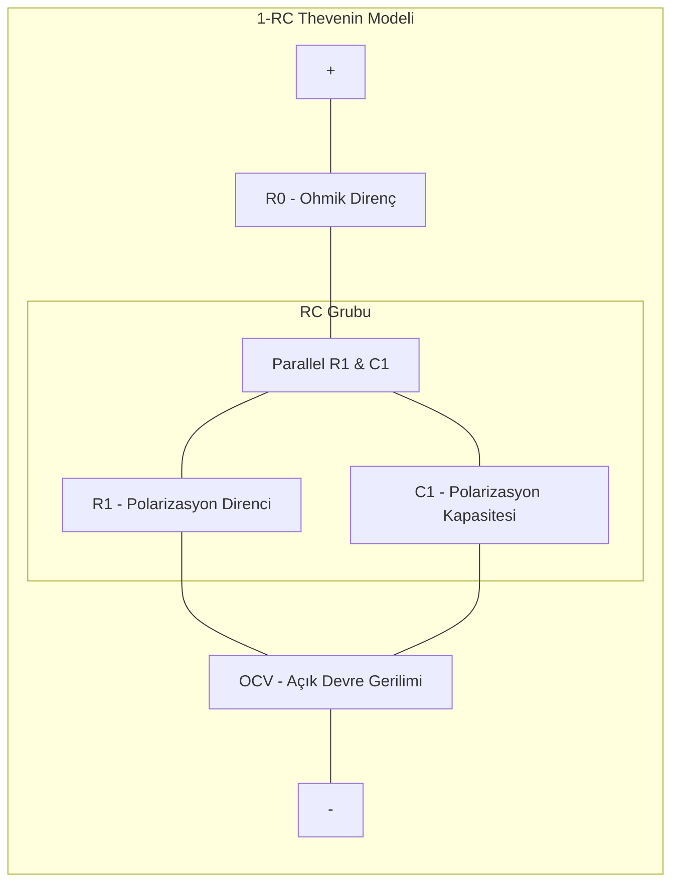
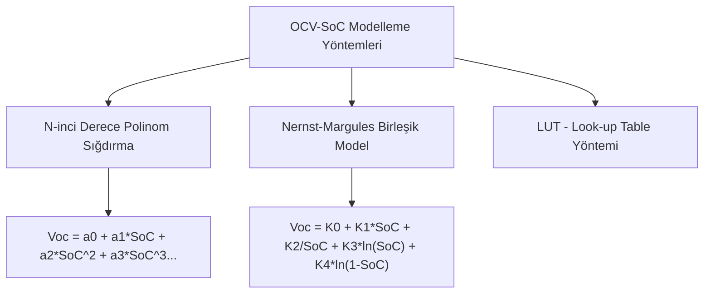

# Modül 1: Hücre Modelleme ve Karakterizasyon

Bu modül, batarya hücrelerinin elektrokimyasal ve elektriksel davranışlarını matematiksel ifadelere dökerek simüle etme yöntemlerini kapsar. Batarya Yönetim Sistemlerinin (BMS) temelini oluşturan hücre modelleri, gerçek zamanlı tahmin algoritmalarının (SoC, SoH) doğruluğu için kritik bir öneme sahiptir.

---

## 📚 1. Hücre Kimyaları Karşılaştırma Analizi

Farklı batarya kimyaları, elektrokimyasal yapıları gereği farklı nominal voltaj, kararlılık ve ömür kriterlerine sahiptir. BMS tasarımı yapılırken hücre kimyasına göre koruma ve kontrol limitleri belirlenir.

| Hücre Kimyası | Nominal Gerilim (V) | Hücre Çalışma Aralığı (V) | Enerji Yoğunluğu (Wh/kg) | Çevrim Ömrü (Döngü) | Termal Kaçak Başlangıcı (°C) | C-Rate Kapasitesi (Şarj/Deşarj) | Temel Avantajlar / Dezavantajlar |
| :--- | :--- | :--- | :--- | :--- | :--- | :--- | :--- |
| **NMC** (Nikel Manganez Kobalt) | 3.6 - 3.7 | 2.5 - 4.2 | 150 - 250 | 1,000 - 2,000 | ~210 °C | Orta (1C / 3C) | **(+):** Yüksek enerji yoğunluğu, hafiflik. **(-):** Kobalt kullanımı, termal hassasiyet. |
| **LFP** (Lityum Demir Fosfat) | 3.2 | 2.0 - 3.65 | 90 - 160 | 3,000 - 6,000+ | ~270 °C | Yüksek (1C / 10C) | **(+):** Üstün termal kararlılık, uzun ömür, güvenli. **(-):** Düşük enerji yoğunluğu, düz OCV eğrisi. |
| **LTO** (Lityum Titanat) | 2.4 | 1.5 - 2.8 | 70 - 110 | 10,000 - 20,000+ | ~300+ °C | Çok Yüksek (10C / 30C) | **(+):** Ultra hızlı şarj, ekstrem ömür, soğukta çalışma. **(-):** Çok düşük enerji yoğunluğu, yüksek maliyet. |
| **NCA** (Nikel Kobalt Alüminyum) | 3.6 | 2.5 - 4.2 | 200 - 260 | 1,000 - 1,500 | ~150 °C | Orta (1C / 3C) | **(+):** Çok yüksek enerji yoğunluğu. **(-):** En kararsız kimya, yüksek termal kaçak riski. |

---

## ⚡ 2. Eşdeğer Devre Modelleri (Equivalent Circuit Models - ECM)

Elektriksel eşdeğer devreler, hücrenin elektrokimyasal dinamiklerini direnç (R) ve kapasitör (C) elemanları kullanarak temsil eder. Bu modeller gerçek zamanlı BMS gömülü yazılımlarında çalıştırılabilecek kadar hızlı ve pratiktir.

### A. 1-RC (Thevenin) Modeli
Hücrenin ohmik direncini ($R_0$) ve yavaş polarizasyon dinamiklerini tek bir RC grubuyla modeller.

#### Matematiksel İfadeler:
Terminal gerilimi ($V_t$):
$$V_t(t) = V_{oc}(SoC) - I(t)R_0 - V_{rc}(t)$$

RC grubundaki voltaj düşümü ($V_{rc}$) diferansiyel denklemi:
$$\frac{dV_{rc}(t)}{dt} = -\frac{V_{rc}(t)}{R_1 C_1} + \frac{I(t)}{C_1}$$

### B. 2-RC Modeli
Şarj transferi ($R_1, C_1$) ve kütle difüzyonu ($R_2, C_2$) gibi iki farklı zaman sabitine sahip fiziksel olayı modelleyerek doğruluğu artırır.

#### Durum-Uzay (State-Space) Formülasyonu:
Durum vektörü $\mathbf{x} = [V_{rc1}, V_{rc2}, SoC]^T$ ve girdi $u = I$ olmak üzere:

$$\begin{bmatrix} \dot{V}_{rc1} \\ \dot{V}_{rc2} \\ \dot{SoC} \end{bmatrix} = \begin{bmatrix} -\frac{1}{R_1 C_1} & 0 & 0 \\ 0 & -\frac{1}{R_2 C_2} & 0 \\ 0 & 0 & 0 \end{bmatrix} \begin{bmatrix} V_{rc1} \\ V_{rc2} \\ SoC \end{bmatrix} + \begin{bmatrix} \frac{1}{C_1} \\ \frac{1}{C_2} \\ -\frac{1}{3600 \cdot Q_n} \end{bmatrix} I$$

$$\mathbf{y} = V_t = V_{oc}(SoC) - V_{rc1} - V_{rc2} - I \cdot R_0$$

*(Burada $Q_n$ hücre kapasitesi ($Ah$), deşarj akımı pozitif ($I > 0$) yön kabul edilmiştir.)*

---

## 📈 3. OCV-SoC Karakterizasyonu ve Histerezis

Hücrenin Açık Devre Voltajı ($V_{oc}$), Şarj Durumu ($SoC$) ile doğrudan ilişkilidir. Ancak bu ilişki doğrusal değildir ve sıcaklığa bağlıdır.

### OCV Histerezisi (Hysteresis Effect)
Aynı SoC değerinde, hücrenin şarj edildikten sonraki durağan voltajı ($Voc_{charge}$), deşarj edildikten sonraki durağan voltajından ($Voc_{discharge}$) her zaman bir miktar yüksektir. Bu farka **histerezis** denir ve nikel tabanlı kimyalarda (NMC) az iken, LFP kimyalarında çok belirgindir. Hassas SoC tahmini için histerezis modeli de sisteme dahil edilmelidir.

---

## 💻 Uygulama ve Simülasyon

Modül klasöründeki kodları inceleyerek teorik modellerin Python simülasyonlarını çalıştırabilirsiniz:
*   [cell_model_1RC.py](./cell_model_1RC.py): Gerçekçi OCV polinomu ve dinamik deşarj döngüsüyle hücre voltaj tepkisini veren 1-RC simülasyonu.

---

## 🛠 Kullanılan Araçlar
*   **PyBaMM:** Elektrokimyasal düzeyde pil fiziksel simülasyonları için mükemmel bir Python kütüphanesi.
*   **MATLAB/Simulink:** Batarya Hücre Karakterizasyonu ve Parameter Estimation Toolbox yardımıyla R, C parametrelerinin deneysel veriyle fit edilmesi.
