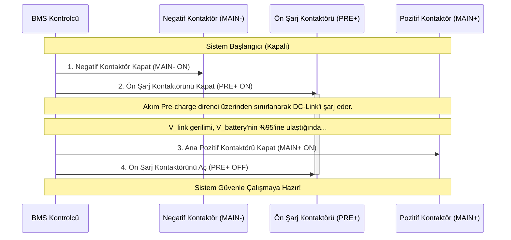

# Modül 2: Güç Elektroniği ve Donanım Tasarımı

Bu modül, batarya hücrelerinden güvenli bir şekilde yüksek hassasiyetli veri alımını, hücrelerin dengelenmesini ve yüksek güç baralarının (busbars) güvenle anahtarlanmasını sağlayan donanım mimarilerini kapsar.

---

## ⚡ 1. BMS Analog Ön-Uç (Analog Front-End - AFE) Mimarisi

BMS donanımının kalbi, her bir hücrenin voltajını mikrovolt hassasiyetinde okuyan ve hücre sıcaklıklarını ölçen **AFE** entegresidir (örn. Analog Devices LTC6811/LTC6813, TI BQ76952).

```mermaid
graph TD
    subgraph Batarya Paketi (High Voltage Domain)
        C1[Hücre 1..12] --> AFE1[AFE Entegresi 1]
        C2[Hücre 13..24] --> AFE2[AFE Entegresi 2]
    end
    
    subgraph Düşük Voltaj Alanı (LV Domain)
        MCU[BMS Ana Kontrolcü - STM32/SPC5]
    end

    AFE2 -- "IsoSPI (İzole Seri Link)" --> AFE1
    AFE1 -- "SPI / IsoSPI Transceiver" --> MCU
    
    style AFE1 fill:#f9f,stroke:#333,stroke-width:2px
    style AFE2 fill:#f9f,stroke:#333,stroke-width:2px
    style MCU fill:#bbf,stroke:#333,stroke-width:2px
```

*   **SPI Daisy Chain (Papatya Zinciri):** Seri bağlı yüzlerce hücrenin voltajını tek bir mikrodenetleyiciden okumak için AFE'ler birbirine diferansiyel izole haberleşme hatları (örn. ADI isoSPI) ile seri bağlanır. Bu yapı, yüksek voltaj domaini (HV) ile düşük voltaj domaini (LV) arasında galvanik izolasyon sağlayarak mikrodenetleyiciyi korur.

---

## 🔍 2. Akım Ölçüm Teknikleri ve Hata Analizi

BMS'te akım ölçümü, **Coulomb Counting** (SoC tahmini) ve aşırı akım koruması için kritik öneme sahiptir. İki ana donanım topolojisi kullanılır:

### A. Shunt Direnci (Şönt Direnç)
Ohm Yasasını ($V = I \cdot R$) temel alır. Çok düşük dirençli (örn. $100\ \mu\Omega$) hassas bir metal direnç üzerinden geçen akımın yarattığı voltaj düşümü ölçülür.

*   **Hata Faktörleri:**
    *   **Isıl Sürüklenme (Thermal Drift):** Direnç üzerinden akım geçtikçe ısınır. Sıcaklık Katsayısı (TCR - Temperature Coefficient of Resistance, $\text{ppm}/^\circ\text{C}$), direnç değerini değiştirerek ölçüm hatasına sebep olur:
        $$R(T) = R_0 \cdot [1 + \alpha(T - T_0)]$$
    *   **Voltaj ADC Offset Hatası:** ADC girişindeki küçük bir kaçak gerilim, düşük akımlarda büyük SoC sürüklenmelerine (drift) yol açar.

### B. Hall-Effect (Manyetik Alan) Sensörü
İletkenden geçen akımın oluşturduğu manyetik alanı ölçerek galvanik izolasyonlu bir çıkış sağlar.

*   **Hata Faktörleri:**
    *   **Manyetik Doyum (Saturation):** Aşırı akım durumunda sensör çekirdeği doyuma ulaşır ve lineerliğini kaybeder.
    *   **Histerezis Hatası:** Çekirdeğin manyetik geçmişi nedeniyle sıfır akımda bile küçük bir voltaj çıkışı (offset) verebilir.

---

## ⚖️ 3. Dengeleme (Balancing) Topolojileri ve Matematiksel Modeli

Seri bağlı hücrelerin kapasite ve iç dirençlerindeki üretim toleransları nedeniyle zamanla şarj seviyeleri (SoC) birbirinden sapar. Dengeleme, en zayıf hücrenin paketin toplam kapasitesini sınırlamasını önler.

### A. Pasif Dengeleme
Şarj seviyesi yüksek olan hücrenin fazla enerjisi, AFE içerisindeki veya dışındaki MOSFET'ler tetiklenerek bir bypass direnci ($R_{bypass}$) üzerinden ısıya dönüştürülür.

*   **Isı ve Akım Hesabı:**
    Dengeleme akımı ($I_{bal}$):
    $$I_{bal} = \frac{V_{cell}}{R_{bypass} + R_{mosfet}}$$
    
    Direnç üzerinde ısıya dönen güç ($P_{heat}$):
    $$P_{heat} = I_{bal}^2 \cdot R_{bypass}$$
    *(BMS kartının termal tasarımı, bu ısının dağıtılabilmesi için genellikle dengeleme akımını $50\text{ mA} - 200\text{ mA}$ arasında sınırlar.)*

### B. Aktif Dengeleme
Enerjiyi harcamak yerine, şarjı fazla olan hücreden alıp kapasitif anahtarlamalı (Switched-Capacitor) veya indüktif (Flyback Converter) devrelerle şarjı düşük hücreye aktarır. Verimliliği çok yüksektir (~%90+) ancak maliyeti ve karmaşıklığı fazladır.

---

## ⚡ 4. Ön Şarj (Pre-charge) Devresi Tasarımı ve Kontaktör Sıralaması

Sistem ilk açıldığında, invertör tarafındaki DC-Link kapasitörleri ($C_{link}$) tamamen boştur. Eğer ana kontaktörler doğrudan kapatılırsa, çok yüksek bir inrush (kaynaklama) akımı akar ve kontaktör kontaklarını birbirine yapıştırır (welding).



---

## 🛡 5. Yüksek Voltaj İzolasyon İzleme (IMD - ISO 6469-3 & UN ECE R100)

Elektrikli araçlarda yüksek voltaj baraları ($\text{HV}+$, $\text{HV}-$), aracın $12\text{ V}$ düşük voltaj şasisinden (LV Chassis Ground) tamamen yalıtılmıştır (Floating HV System). Soğutma sıvısı sızıntısı, kablo izolasyon aşınması veya nem nedeniyle oluşan kaçak dirençler ($R_{iso+}$, $R_{iso-}$) **İzolasyon İzleme Cihazı (IMD)** tarafından sürekli denetlenir.

$$\frac{1}{R_{iso,\text{eq}}} = \frac{1}{R_{iso+}} + \frac{1}{R_{iso-}} \implies R_{iso,\text{eq}} = \frac{R_{iso+} \cdot R_{iso-}}{R_{iso+} + R_{iso-}}$$

**ISO 6469-3 ve UN ECE R100 Güvenlik Eşikleri:**
*   **Sağlıklı Durum (Normal):** $R_{iso} \ge 500\ \Omega/\text{V}$ ($400\text{ V}$ bir paket için $\ge 200\text{ k}\Omega$)
*   **Uyarı Eşiği (Warning / Servis Gerekli):** $100\ \Omega/\text{V} \le R_{iso} < 500\ \Omega/\text{V}$
*   **Kritik İzolasyon Hatası (Emergency Shutdown):** $R_{iso} < 100\ \Omega/\text{V}$ ($400\text{ V}$ paket için $< 40\text{ k}\Omega$ — Kontaktörler derhal açılır!)

---

## 💻 Uygulama ve Simülasyon

*   [precharge_simulation.py](./precharge_simulation.py): Uygun pre-charge direnci ve süresini hesaplayan, kondansatör gerilim ve akım değişimlerini grafikleyen Python simülasyonu.
*   [cell_balancing_simulation.py](./cell_balancing_simulation.py): 12S batarya modülünde **Pasif (Şönt Direnç)** ve **Aktif (İndüktif Buck-Boost)** dengeleme algoritmalarının yakınsama süresi, atık ısı (Wh) ve kullanılabilir paket kapasitesi açısından karşılaştırması ile **ISO 6469-3 IMD İzolasyon Testi** simülasyonu.
