# Modül 3: BMS Yazılım Mimarisi

BMS gömülü yazılımları, otomotiv standartlarına ve yüksek seviyeli fonksiyonel güvenlik gereksinimlerine (ISO 26262) göre tasarlanmalıdır. Bu modül, deterministik gerçek zamanlı işletim sistemlerini (RTOS), çok katmanlı yazılım mimarilerini (AUTOSAR) ve güvenli kodlama standartlarını ele alır.

---

## 🏗 1. AUTOSAR Tabanlı Çok Katmanlı Yazılım Mimarisi

Modern otomotiv yazılımları, donanım bağımsızlığı sağlamak amacıyla katmanlı bir yapıda tasarlanır. Bu yapı, BMS kodunun farklı mikrodenetleyicilere (örn. STM32'den Infineon Aurix'e) minimum eforla taşınabilmesini sağlar.

```mermaid
graph TD
    subgraph ASW (Application Software Layer)
        SoC[SoC/SoH Kestirim Modülü]
        Bal[Balans Kontrol Modülü]
        Prot[Koruma ve Teşhis Modülü]
    end

    subgraph RTE (Runtime Environment)
        RTE_Bus[Sinyal ve Veri Yönlendirme Köprüsü]
    end

    subgraph BSW (Basic Software Layer)
        OS[RTOS - FreeRTOS / OSEK]
        Diag[UDS/OBD Teşhis Servisleri]
        subgraph MCAL (Microcontroller Abstraction Layer)
            ADC[ADC Sürücüsü]
            SPI[SPI Sürücüsü]
            CAN[CAN Sürücüsü]
        end
    end

    ASW --> RTE
    RTE --> BSW
    MCAL --> HW[Fiziksel MCU Donanımı]

    style ASW fill:#f9f,stroke:#333,stroke-width:2px
    style RTE fill:#ffb,stroke:#333,stroke-width:2px
    style BSW fill:#bbf,stroke:#333,stroke-width:2px
```

*   **ASW (Uygulama Katmanı):** Batarya kontrol lojiklerini içerir (SoC tahmini, koruma sınır denetimleri vb.). Donanımdan tamamen habersizdir, verileri RTE üzerinden alır.
*   **RTE (Çalışma Zamanı Ortamı):** ASW ile alt katmanlar arasındaki haberleşmeyi sağlayan soyutlama katmanıdır.
*   **BSW (Temel Yazılım Katmanı):** Donanım sürücüleri (MCAL), işletim sistemi, CAN haberleşme yığınları ve hata günlükleme gibi alt seviye servisleri sunar.

---

## 🔄 2. Sonlu Durum Makinesi (Finite State Machine - FSM)

BMS, sistemin o anki durumuna (State) göre kararlar veren bir FSM mimarisi üzerine kurulur. Durumlar arası geçişler, hata durumlarında en hızlı şekilde güvenli duruma (Safe State) geçecek şekilde kurgulanır.

| Mevcut Durum | Tetikleyici Koşul (Event) | Hedef Durum | Gerçekleşen Eylem / İşlem |
| :--- | :--- | :--- | :--- |
| **INIT** | Güç açılması, Self-Test Başarılı | **STANDBY** | Donanım (AFE, Sensörler) kurulur, kontaktörler açık tutulur. |
| **STANDBY** | Akım algılandı (Deşarj) | **DISCHARGE** | Ana Negatif ve Pozitif kontaktörler kapatılır. |
| **STANDBY** | Şarj fişi takıldı (Akım < 0) | **CHARGE** | Şarj kontaktörleri / Şarj profili etkinleştirilir. |
| **CHARGE** | Hücre voltajı $\ge V_{max}$ veya Şarj Bitti | **STANDBY** | Şarj kontaktörü açılır, şarj sonlandırılır. |
| **ANY STATE** | Kritik Hata (Over-Voltage, Over-Temp, Over-Current) | **FAULT** | **CRITICAL:** Kontaktörler milisaniyeler içinde açılarak batarya izole edilir. Hata kodu (DTC) kalıcı hafızaya yazılır. |
| **FAULT** | UDS Üzerinden Reset / Hata Temizleme | **INIT** | Hatalar silinir, sistem yeniden başlatılır. |

---

## ⏱ 3. Real-Time Görev (Task) Yönetimi ve Determinizm

BMS gömülü yazılımının zamanlaması, en kötü durum senaryolarında bile deterministik (tahmin edilebilir zaman sınırları içinde) olmak zorundadır. Bu nedenle RTOS üzerinde farklı önceliklerde periyodik görevler tanımlanır:

```mermaid
gantt
    title BMS RTOS Görev Dağılımı ve Zamanlaması
    dateFormat  SS
    axisFormat %L ms

    section 1ms Task
    Aşırı Akım ve Kısa Devre Koruması (Kesme Tabanlı) :active, 00, 01
    section 10ms Task
    Hücre Gerilimleri ve Paket Akımı Okuma (ADC/SPI) :crit, 00, 10
    section 100ms Task
    EKF SoC Tahmini & Termal Kontrol (PID) : 00, 50
    section 1000ms Task
    Pasif Dengeleme Kararı & Diagnostik Loglama : 00, 99
```



1.  **1 ms Task (Kritik Öncelik):** Donanım kesmesi (Interrupt) tabanlıdır. Kısa devre veya aşırı akım durumunda mikro saniyeler içinde kontaktörleri açma sinyalini tetikler.
2.  **10 ms Task (Yüksek Öncelik):** AFE üzerindeki hücre voltajları ve sıcaklıkları SPI üzerinden okunur. Debounce (hata doğrulama) filtreleri koşturulur.
3.  **100 ms Task (Orta Öncelik):** Extended Kalman Filtresi çalıştırılarak SoC güncellenir. Termal PID algoritması fan hızını belirler.
4.  **1000 ms Task (Düşük Öncelik):** Hücrelerin dengeleme kararları verilir, UDS üzerinden teşhis mesajları (DTC) güncellenir ve EEPROM kalıcı hafızasına kaydedilir.

---

## 🛡 4. MISRA C++:2008 ve Gömülü Yazılım Güvenliği

BMS gibi güvenlik kritik otomotiv yazılımlarında hataları minimuma indirmek amacıyla **MISRA C:2012** ve **MISRA C++:2008** standartlarına uyulması zorunludur:

*   **Dinamik Bellek Yönetimi Yasaktır:** `malloc`, `free`, `new` ve `delete` kullanımı kesinlikle yasaktır. Dinamik bellek yönetimi, bellek bölünmesine (fragmentation) ve çalışma zamanında bellek yetersizliği çökmelerine neden olabilir.
*   **Pointer Aritmetiği Kısıtlaması:** Göstericiler (pointers) üzerinde `ptr++` veya `ptr + 5` gibi aritmetik işlemler yapılamaz. Bunun yerine dizi indeksleri tercih edilmelidir.
*   **Exception Handling Yasaktır:** `try-catch` blokları, çalışma zamanı yükü (overhead) getirdiği ve determinizmi bozduğu için kullanılmaz. Hata yönetimleri dönüş kodları (`enum class Result`) ile yapılır.
*   **Sonsuz Döngü Koruması:** Tüm `while` ve `for` döngülerinin maksimum iterasyon sınırları olmak zorundadır. Asla ucu açık döngü bırakılmaz.

---

## 💻 Uygulama ve Simülasyon

*   [bms_fsm.cpp](./bms_fsm.cpp): C++11 standartlarına uygun, alarm filtrelemeli, durum desenine sahip ve teşhis hata kodu (DTC) destekli profesyonel FSM simülasyonu.
