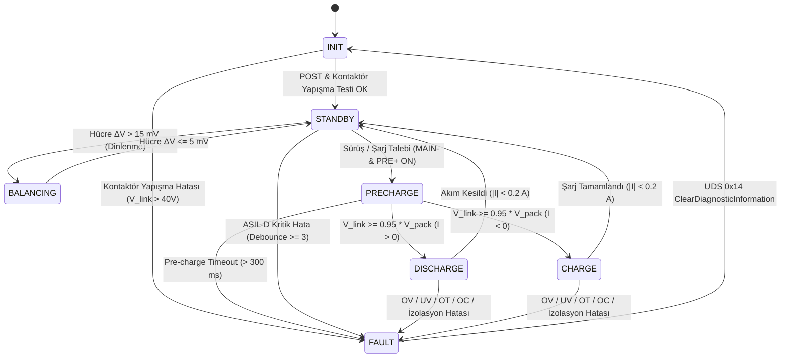
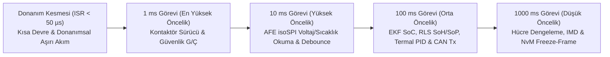

# Modül 3: BMS Yazılım Mimarisi

BMS gömülü yazılımları, otomotiv standartlarına ve yüksek seviyeli fonksiyonel güvenlik gereksinimlerine (ISO 26262) göre tasarlanmalıdır. Bu modül, deterministik gerçek zamanlı işletim sistemlerini (RTOS), çok katmanlı yazılım mimarilerini (AUTOSAR) ve güvenli kodlama standartlarını ele alır.

---

## 🏗 1. AUTOSAR Tabanlı Çok Katmanlı Yazılım Mimarisi

Modern otomotiv yazılımları, donanım bağımsızlığı sağlamak amacıyla katmanlı bir yapıda tasarlanır. Bu yapı, BMS kodunun farklı mikrodenetleyicilere (örn. STM32'den Infineon Aurix'e) minimum eforla taşınabilmesini sağlar.

```mermaid
graph TD
    subgraph ASW (Application Software Layer)
        SoC[SoC/SoH Kestirim Modülü]
        Bal[Balans Kontrol Modülü]
        Prot[Koruma ve Teşhis Modülü]
    end

    subgraph RTE (Runtime Environment)
        RTE_Bus[Sinyal ve Veri Yönlendirme Köprüsü]
    end

    subgraph BSW (Basic Software Layer)
        OS[RTOS - FreeRTOS / OSEK]
        Diag[UDS/OBD Teşhis Servisleri]
        subgraph MCAL (Microcontroller Abstraction Layer)
            ADC[ADC Sürücüsü]
            SPI[SPI Sürücüsü]
            CAN[CAN Sürücüsü]
        end
    end

    ASW --> RTE
    RTE --> BSW
    MCAL --> HW[Fiziksel MCU Donanımı]

    style ASW fill:#f9f,stroke:#333,stroke-width:2px
    style RTE fill:#ffb,stroke:#333,stroke-width:2px
    style BSW fill:#bbf,stroke:#333,stroke-width:2px
```

*   **ASW (Uygulama Katmanı):** Batarya kontrol lojiklerini içerir (SoC tahmini, koruma sınır denetimleri vb.). Donanımdan tamamen habersizdir, verileri RTE üzerinden alır.
*   **RTE (Çalışma Zamanı Ortamı):** ASW ile alt katmanlar arasındaki haberleşmeyi sağlayan soyutlama katmanıdır.
*   **BSW (Temel Yazılım Katmanı):** Donanım sürücüleri (MCAL), işletim sistemi, CAN haberleşme yığınları ve hata günlükleme gibi alt seviye servisleri sunar.

---

## 🔄 2. Sonlu Durum Makinesi (Finite State Machine - FSM)

BMS, sistemin o anki durumuna (State) göre kararlar veren deterministik bir FSM mimarisi üzerine kurulur. Durumlar arası geçişler, hata durumlarında en hızlı şekilde güvenli duruma (**Safe State - FAULT**) geçecek şekilde kurgulanır.



| Mevcut Durum | Tetikleyici Koşul (Event) | Hedef Durum | Gerçekleşen Eylem / İşlem |
| :--- | :--- | :--- | :--- |
| **INIT** | Güç açılması, Self-Test & Kontaktör Yapışma Testi Başarılı | **STANDBY** | Donanım (AFE, Sensörler) kurulur, $V_{\text{link}} < 40\text{ V}$ doğrulanır, kontaktörler açık tutulur. |
| **STANDBY** | Sürüş veya Şarj Talebi | **PRECHARGE** | `MAIN-` ve `PRE+` kontaktörleri kapatılarak DC-Link kapasitörü sınırlı akımla doldurulur. |
| **PRECHARGE** | $V_{\text{link}} \ge 0.95 \cdot V_{\text{pack}}$ ($t < 300\text{ ms}$) | **DISCHARGE / CHARGE** | `MAIN+` kapatılır, `PRE+` açılır, yüksek güç akışı başlar. |
| **STANDBY** | Hücreler arası gerilim farkı $\Delta V > 15\text{ mV}$ | **BALANCING** | AFE pasif şönt MOSFET'leri veya aktif dengeleme devresi çalıştırılır. |
| **ANY STATE** | Kritik Hata (`OV`, `UV`, `OT`, `OC`, `ISO_FAULT`, `WELD`) | **FAULT** | **CRITICAL:** Tüm kontaktörler derhal açılarak batarya izole edilir. NvM belleğe **Freeze-Frame** kaydedilir. |
| **FAULT** | UDS `0x14` Üzerinden Hata Temizleme | **INIT** | Hata sayaçları sıfırlanır, sistem yeniden öz-test (POST) sürecine girer. |

---

## ⏱ 3. Real-Time Görev (Task) Yönetimi ve Determinizm

BMS gömülü yazılımının zamanlaması, en kötü durum çalışma süresi (**WCET - Worst-Case Execution Time**) sınırları içinde deterministik olmak zorundadır. RTOS üzerinde Rate-Monotonic Scheduling (RMS) prensibiyle farklı önceliklerde periyodik görevler koşturulur:



| Görev Periyodu | RTOS Önceliği | WCET Bütçesi | Sorumlu Olduğu Kritik Fonksiyonlar |
| :--- | :--- | :--- | :--- |
| **ISR (Kesme)** | Donanım Seviyesi | $< 50\ \mu\text{s}$ | Analog karşılaştırıcı (Comparator) tabanlı donanımsal kısa devre ($I > 500\text{ A}$) kesmesi. |
| **1 ms Task** | Çok Yüksek (`Prio 4`) | $< 250\ \mu\text{s}$ | Kontaktör bobin PWM kontrolü, Watchdog (`WdgM`) alive-counter beslemesi. |
| **10 ms Task** | Yüksek (`Prio 3`) | $< 2.5\text{ ms}$ | AFE isoSPI papatya zinciri üzerinden tüm hücre gerilim/sıcaklıklarının okunması, CRC doğrulaması ve **Asimetrik Yukarı/Aşağı Debounce** filtreleri. |
| **100 ms Task** | Orta (`Prio 2`) | $< 18.0\text{ ms}$ | **Extended Kalman Filter (EKF)** SoC tahmini, **RLS** iç direnç takibi, **SoP** güç limitleri, Termal PID ve `0x351` CAN mesaj yayını. |
| **1000 ms Task** | Düşük (`Prio 1`) | $< 80.0\text{ ms}$ | Pasif/Aktif balans kararları, UDS (`ISO 14229`) teşhis istekleri ve EEPROM/Flash **NvM Freeze-Frame** kayıtları. |

---

## 🛡 4. MISRA C++:2008, Kontaktör Yapışma Testi ve NvM Freeze-Frame

BMS gibi **ASIL-D** güvenlik kritik otomotiv yazılımlarında **MISRA C:2012** ve **MISRA C++:2008** standartlarına uyulması zorunludur:

*   **Dinamik Bellek Yönetimi Yasaktır:** `malloc`, `free`, `new` ve `delete` kullanımı kesinlikle yasaktır. Tüm veri yapıları (örn. `std::array<FreezeFrame, 8>`) derleme zamanında statik olarak tahsis edilir.
*   **Kontaktör Yapışma Tespiti (Contactor Weld Check):** Sistem `INIT` aşamasındayken ve kontaktörlere "AÇIK" komutu veriliyorken inverter tarafındaki $V_{\text{link}}$ gerilimi ölçülür. Eğer $V_{\text{link}} > 40\text{ V}$ ise kontaktör kontaklarının ark nedeniyle birbirine kaynadığı (`DTC 0x9005 - CONTACTOR_WELD_FAULT`) tespit edilir ve sürüş engellenir.
*   **NvM Freeze-Frame Kaydı:** Bir hata oluştuğu anda sadece hata kodu (DTC) değil; hatanın gerçekleştiği milisaniye zaman damgası, hücre gerilimi, paket akımı, sıcaklık ve izolasyon direnci kalıcı belleğe (Non-Volatile Memory) anlık görüntü (**Freeze-Frame**) olarak kaydedilir.

---

## 💻 Uygulama ve Simülasyon

*   [bms_fsm.cpp](./bms_fsm.cpp): MISRA C++ ilkelerine uygun (dinamik bellek ve exception içermeyen), `PRECHARGE`, `BALANCING`, **Kontaktör Yapışma Testi**, **Asimetrik Debounce** ve **NvM Freeze-Frame** özelliklerine sahip deterministik BMS FSM simülasyonu.
