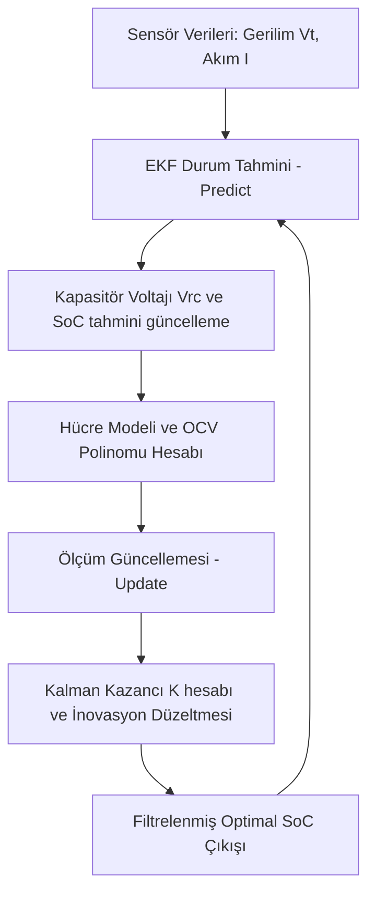

# Modül 4: Kestirim Algoritmaları (Estimation Algorithms)

Bataryanın en kritik parametreleri olan Şarj Durumu (State of Charge - SoC), Sağlık Durumu (State of Health - SoH) ve Güç Durumu (State of Power - SoP) doğrudan fiziksel sensörlerle ölçülemez. Bu modül, gürültülü sensör verilerinden (akım, voltaj, sıcaklık) bu iç durumları en yüksek doğrulukla kestiren optimal filtreleme ve tahmin algoritmalarını kapsar.

---

## 📈 1. State of Charge (SoC) Tahmini

SoC, bataryanın o anki kullanılabilir enerji yüzdesini ifade eder. BMS'te en çok kullanılan iki ana yöntem şunlardır:

### A. Coulomb Counting (Ah Entegrasyonu)
Akımın zaman üzerinden entegre edilmesi esasına dayanır.
$$SoC(t) = SoC(t_0) - \frac{1}{3600 \cdot Q_n} \int_{t_0}^{t} \eta \cdot I(\tau) d\tau$$
*(Burada $Q_n$ hücre kapasitesi ($Ah$), $I$ akım ($A$, deşarj pozitif), $\eta$ kulombik verimdir.)*

*   **Dezavantajları:**
    *   **Akım Sensör Gürültüsü (Drift):** Sensördeki küçük bir offset hatası bile zamanla birikerek büyük SoC sapmalarına yol açar.
    *   **Başlangıç Değeri Bağımlılığı:** $SoC(t_0)$ başlangıç değeri bilinmiyorsa veya hatalıysa, tüm tahminler hatalı olur.

### B. Extended Kalman Filter (EKF)
Hücrenin dinamik 1-RC Thevenin elektrik modelini durum denklemlerine dökerek, akım ve voltaj üzerindeki beyaz gürültüyü (noise) filtreler ve optimal SoC tahmini üretir.



---

## 🧮 2. EKF Matematiksel Formülasyonu

1-RC Thevenin modeli için durum vektörü $\mathbf{x}_k = [V_{rc, k}, SoC_k]^T$, girdi $u_k = I_k$ ve ölçüm $z_k = V_{t, k}$ olarak tanımlanır.

### Durum-Uzay Model Denklemleri
$$\mathbf{x}_k = \mathbf{A}_{k-1} \mathbf{x}_{k-1} + \mathbf{B}_{k-1} u_{k-1} + \mathbf{w}_{k-1}$$
$$z_k = h(\mathbf{x}_k, u_k) + v_k$$

Burada:
$$\mathbf{A} = \begin{bmatrix} e^{-\frac{dt}{R_1 C_1}} & 0 \\ 0 & 1 \end{bmatrix}, \quad \mathbf{B} = \begin{bmatrix} R_1(1 - e^{-\frac{dt}{R_1 C_1}}) \\ -\frac{dt}{3600 \cdot Q_n} \end{bmatrix}$$
$$h(\mathbf{x}_k, u_k) = OCV(SoC_k) - V_{rc, k} - I_k R_0$$

### EKF Algoritma Adımları

#### 1. Zaman Güncelleme (Prediction - Tahmin)
*   **Durum Kestirimi:**
    $$\hat{\mathbf{x}}_k^- = \mathbf{A} \hat{\mathbf{x}}_{k-1}^+ + \mathbf{B} u_{k-1}$$
*   **Hata Kovaryans Kestirimi:**
    $$\mathbf{P}_k^- = \mathbf{F}_{k-1} \mathbf{P}_{k-1}^+ \mathbf{F}_{k-1}^T + \mathbf{Q}$$
    *(Burada $\mathbf{F}_{k-1} = \mathbf{A}$ durum geçiş Jacobian matrisidir. $\mathbf{Q}$ proses gürültü kovaryansıdır.)*

#### 2. Ölçüm Güncelleme (Correction - Düzeltme)
*   **Ölçüm Jacobian Matrisi ($\mathbf{H}_k$):**
    $$\mathbf{H}_k = \left. \frac{\partial h(\mathbf{x})}{\partial \mathbf{x}} \right|_{\hat{\mathbf{x}}_k^-} = \begin{bmatrix} -1 & \left. \frac{d OCV(SoC)}{d SoC} \right|_{\widehat{SoC}_k^-} \end{bmatrix}$$
    *($\frac{d OCV}{d SoC}$ terimi, OCV-SoC polinomunun türevidir.)*
*   **Kalman Kazancı ($\mathbf{K}_k$):**
    $$\mathbf{K}_k = \mathbf{P}_k^- \mathbf{H}_k^T (\mathbf{H}_k \mathbf{P}_k^- \mathbf{H}_k^T + R)^{-1}$$
    *($R$ voltaj ölçüm gürültüsü varyansıdır.)*
*   **Durum Güncellemesi (İnovasyon Düzeltmesi):**
    $$\hat{\mathbf{x}}_k^+ = \hat{\mathbf{x}}_k^- + \mathbf{K}_k (z_k - h(\hat{\mathbf{x}}_k^-, u_k))$$
*   **Hata Kovaryans Güncellemesi:**
    $$\mathbf{P}_k^+ = (\mathbf{I} - \mathbf{K}_k \mathbf{H}_k) \mathbf{P}_k^-$$

---

## 🩺 3. State of Health (SoH) ve Parametre Kestirimi

SoH, bataryanın ömrünü ve yıpranma durumunu ifade eder. Sıfır hücre için SoH %100 kabul edilirken, bu değer zamanla kapasite kaybı ve iç direnç artışıyla düşer.

*   **Kapasite Kestirimi:** Akıllı şarj döngülerinde (örneğin %20'den %90'a sabit şarj) Coulomb integration ve EKF farkları karşılaştırılarak toplam kapasite ($Q_{max}$) güncellenir.
*   **İç Direnç Kestirimi:** **Recursive Least Squares (RLS)** filtresi kullanılarak ohmik direnç ($R_0$) sürekli takip edilir. $R_0$ değeri başlangıç değerinin iki katına ulaştığında batarya ömrünü tamamlamış (EOL - End of Life, genellikle %80 SoH) kabul edilir.

---

## ⚡ 4. State of Power (SoP) Tahmini

SoP, bataryanın anlık olarak güvenli sınırlar (voltaj, akım, sıcaklık) içinde verebileceği maksimum şarj ve deşarj gücüdür.
*   **HPPC (Hybrid Pulse Power Characterization):** Hücreye uygulanan kısa süreli deşarj/şarj darbeleriyle deşarj direnç limitleri çıkarılır.
*   **Dinamik Akım Sınırları:** EKF'in tahmin ettiği $V_{rc}$ ve $SoC$ değerleri kullanılarak, hücre voltajının minimum voltaj limitini aşmadan çekilebilecek maksimum akım ($I_{max\_dch}$) formüle edilir:
    $$I_{max\_dch} = \frac{OCV(SoC) - V_{rc} - V_{min}}{R_0}$$

---

## 🧪 5. LFP Kimyasında Düz OCV ve Histerezis Problemi

Lityum Demir Fosfat (LFP) pillerde $OCV(SoC)$ eğrisi, orta aralıkta (%20 - %90 SoC) son derece düz bir plato çizer. Bu platoda türev $\frac{dOCV}{dSoC} \approx 0$ değerine çok yakındır.

### A. Gürültü Hassasiyeti (Noise Sensitivity)
Hücre voltajı ölçen ADC'ler üzerindeki en ufak bir donanımsal gürültü ($\pm 2\text{ mV}$), EKF Jacobian matrisi $\mathbf{H} = \begin{bmatrix} -1 & \frac{d OCV}{d SoC} \end{bmatrix}$ içerisindeki türevin sıfıra yakın olması nedeniyle durum güncelleme adımında ($\mathbf{K}_k [\mathbf{y}_k - \mathbf{h}(\hat{\mathbf{x}}_k^-)]$) kararsızlıklara ve SoC kestiriminde **%15'e varan büyük hatalara** yol açar.

### B. OCV Histerezis Etkisi
LFP pillerde gerilim histerezisi (şarj ve deşarj eğrileri arasındaki fark) oldukça belirgindir. Hücrenin en son şarj mı deşarj mı edildiği bilgisi voltajı doğrudan etkiler. Bu etkiyi modellemek için durum vektörüne tekil bir **Histerezis Durumu** ($h$) eklenir:

$$h(k+1) = \exp\left(-\gamma |I(k)| dt\right) h(k) + \left[1 - \exp\left(-\gamma |I(k)| dt\right)\right] \text{sgn}(I(k))$$

Burada $\gamma$ histerezis sönüm katsayısıdır. Bu sayede güncellenmiş hücre gerilim denklemi:
$$V_t = OCV(SoC) - I R_0 - V_{rc} + M \cdot h(k)$$
*(M, histerezis genlik katsayısıdır. Bu model sayesinde EKF kararlılığı LFP pillerde de korunur.)*

---

## ☁️ 6. Bulut Tabanlı (Cloud-BMS) Yapay Zekalı Kestirim

Geleneksel batarya yönetim sistemlerinin araç üzerindeki işlem gücü sınırlarını aşmak amacıyla geliştirilen **Cloud-BMS** mimarisi, fiziksel modeller ile yapay zekayı birleştirir.

```
+--------------------+   Telemetri (V, I, T)   +----------------------------+
|  Araç Üstü Edge    | ----------------------> |    Bulut Tabanlı Dijital   |
|   (BMS / MCU)      |                         |         İkiz (Cloud)       |
|                    | <---------------------- | - DFN Elektrokimyasal Model|
| - 1-RC ECM Modeli  |    OTA Parametreleri    | - LSTM / GRU Yapay Zeka     |
| - Gerçek Zamanlı   |      (R0, C1, Cap)      | - GPR ile SoH/RUL Analizi   |
|   Limit Kontrolü   |                         |                            |
+--------------------+                         +----------------------------+
```

*   **Fiziksel Dijital İkiz (DFN Modeli):** Bulut sunucularında, hücrenin iç lityum iyon konsantrasyonunu ve katı faz difüzyonunu modelleyen kısmi diferansiyel denklemlere dayalı **Doyle-Fuller-Newman (DFN)** elektrokimyasal modeli çözülür.
*   **AI/ML Tabanlı Tahmin:** Zaman serisi verilerini işleyen **LSTM (Long Short-Term Memory)** ve **GRU (Gated Recurrent Unit)** yapay sinir ağları, hücrelerin voltaj, akım ve sıcaklık profillerinden doğrudan $SoC$ ve $SoH$ tahmini yapar.
*   **Gaussian Process Regression (GPR):** Olasılıksal bir makine öğrenimi tekniği olan GPR kullanılarak bataryanın kalan ömrü (RUL - Remaining Useful Life) ve yaşlanma trendleri güven aralıklarıyla birlikte (%95 olasılık sınırlarında) hesaplanır ve OTA (Over-The-Air) ile gömülü yazılıma kalibrasyon parametresi olarak iletilir.

---

## 💻 Uygulama ve Simülasyon

*   [ekf_soc_estimator.py](./ekf_soc_estimator.py): NumPy matris matematiğiyle yazılmış, gerçek voltaj gürültüsünü filtreleyerek SoC'yi hassas bir şekilde takip eden EKF Python simülasyonu.
*   [rls_soh_sop_estimator.py](./rls_soh_sop_estimator.py): Unutma faktörlü **RLS** (ARX modeli) ile çevrimiçi $R_0, R_1, C_1$ kestirimi, direnç bazlı **SoH** takibi ve gerilim/SoC/donanım akım kısıtlarını birleştiren 10 saniyelik ufuklu **SoP** hesabı.


