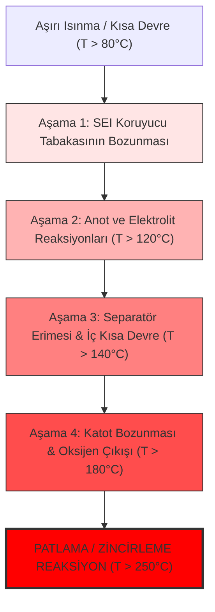

# Modül 5: Fonksiyonel Güvenlik ve Termal Yönetim

Batarya sistemlerinde güvenlik (Safety) ve termal kararlılık, tasarımın en kritik unsurlarıdır. Lityum-iyon piller dar bir sıcaklık aralığında ($15^\circ\text{C} - 35^\circ\text{C}$) güvenle çalışır. Bu modül, **ISO 26262** standartlarına uygun fonksiyonel güvenliği ve aktif termal yönetim kontrolörlerini ele alır.

---

## 🛡 1. ISO 26262 ve BMS Fonksiyonel Güvenliği

Otomotiv dünyasında elektrikli araç bataryaları güvenlik açısından en yüksek risk grubundadır. Bu nedenle BMS tasarımı, **ISO 26262** fonksiyonel güvenlik standardına göre şekillendirilir.

### HARA (Tehlike Analizi ve Risk Değerlendirmesi)
BMS tasarımı başlarken sistemin olası tehlikeleri analiz edilir. Risk, üç parametreye göre sınıflandırılır:
1.  **Severity (Şiddet - S0-S3):** Olası kazanın yaratacağı fiziksel zarar derecesi.
2.  **Exposure (Maruz Kalma - E0-E4):** Tehlikeli durumun trafikte gerçekleşme olasılığı.
3.  **Controllability (Kontrol Edilebilirlik - C0-C3):** Sürücünün tehlikeyi bertaraf edebilme yeteneği.

$$\text{Risk Seviyesi (ASIL)} = f(S, E, C)$$

#### BMS ASIL Güvenlik Hedefleri (Safety Goals - SG)

| Tehlike Tanımı | Şiddet (S) | Maruz Kalma (E) | Kontrol Edilebilirlik (C) | ASIL Derecesi | Temel Güvenlik Hedefi (Safety Goal) |
| :--- | :--- | :--- | :--- | :--- | :--- |
| **Aşırı Şarj (Overcharging):** Aşırı voltaj sonucu hücrenin patlaması/yanması. | S3 | E4 | C3 | **ASIL D** | **SG1:** Hücre aşırı şarjını ve aşırı voltajını önle. |
| **Aşırı Isınma (Overheating):** Aşırı sıcaklık nedeniyle termal kaçak. | S3 | E4 | C3 | **ASIL D** | **SG2:** Bataryanın termal kaçak durumuna girmesini önle. |
| **Aşırı Akım (Overcurrent):** Kısa devre veya aşırı deşarj ile kabloların yanması. | S3 | E4 | C2 | **ASIL C** | **SG3:** Hücre aşırı akım limitlerinin aşılmasını önle. |

---

## ⚡ 2. Termal Kaçak (Thermal Runaway) Mekanizması ve Aşamaları

Lityum-iyon pillerde sıcaklığın kontrolsüz şekilde artması ve hücre içi ekzotermik reaksiyonların zincirleme olarak birbirini tetiklemesiyle **Termal Kaçak** oluşur.

*   **Aşama 1 ($80^\circ\text{C} - 120^\circ\text{C}$):** Anot üzerindeki koruyucu SEI (Solid Electrolyte Interphase) tabakası ısı nedeniyle çözünür. Anot lityumu elektrolit ile doğrudan temas ederek ekzotermik reaksiyona girer.
*   **Aşama 2 ($120^\circ\text{C} - 140^\circ\text{C}$):** Elektrolit ve aktif malzemeler bozunarak yanıcı gazlar üretir. Hücre içi basınç artar.
*   **Aşama 3 ($140^\circ\text{C} - 180^\circ\text{C}$):** Hücre içi separatör (katot ve anot arasındaki yalıtkan katman) erir. Çok yüksek akımlı iç kısa devreler başlar.
*   **Aşama 4 ($180^\circ\text{C}+$):** Katot yapısı çöker, serbest kalan oksijen gazı yanıcı organik solventlerle birleşir ve saniyeler içinde şiddetli yangın ve patlama gerçekleşir.

---

## 🌡 3. NTC Sıcaklık Sensörleri ve Kalibrasyon

BMS'te sıcaklık ölçümü için negatif sıcaklık katsayılı dirençler (**NTC**) kullanılır. Sıcaklık arttıkça direnç düşer. Bu doğrusal olmayan ilişki iki matematiksel modelle kalibre edilir:

### A. Steinhart-Hart Denklemi (En Hassas Yöntem)
$$\frac{1}{T} = A + B \ln(R) + C (\ln(R))^3$$
*(Burada $T$ Kelvin cinsinden sıcaklık, $R$ NTC direncidir. $A, B, C$ kalibrasyon katsayılarıdır.)*

### B. Beta Denklemi (Daha Hızlı ve Pratik Yöntem)
$$\frac{1}{T} = \frac{1}{T_0} + \frac{1}{\beta} \ln\left(\frac{R}{R_0}\right)$$
*(Burada $R_0$, $T_0 = 298.15\text{ K}$ ($25^\circ\text{C}$) sıcaklığındaki nominal dirençtir. $\beta$ ise NTC malzeme katsayısıdır.)*

---

## 🎛 4. PID Kontrollü Aktif Soğutma Mimarisi

BMS, hücre sıcaklığını ideal seviyede tutmak için fan hızını veya soğutma sıvısı pompasının debisini kontrol eder. Sürekli zaman PID denklemi:

$$u(t) = K_p e(t) + K_i \int_{0}^{t} e(\tau) d\tau + K_d \frac{de(t)}{dt}$$

Burada:
*   $e(t) = T_{measured}(t) - T_{target}$ (Sıcaklık Hatası)
*   $u(t)$ Soğutma kontrol çıktısı (PWM sinyali veya pompa devri)
*   $K_p, K_i, K_d$ sırasıyla Oransal, İntegral ve Türevsel kontrolör kazançlarıdır.

---

## 💻 Uygulama ve Simülasyon

*   [thermal_pid_control.py](./thermal_pid_control.py): Hücrelerin Joule ısınması ($I^2 R$) ve entropik ısı üretimini modelleyen, bu ısıyı aktif bir PID kontrolör yardımıyla soğutan yüksek sadakatli Python simülasyonu.
