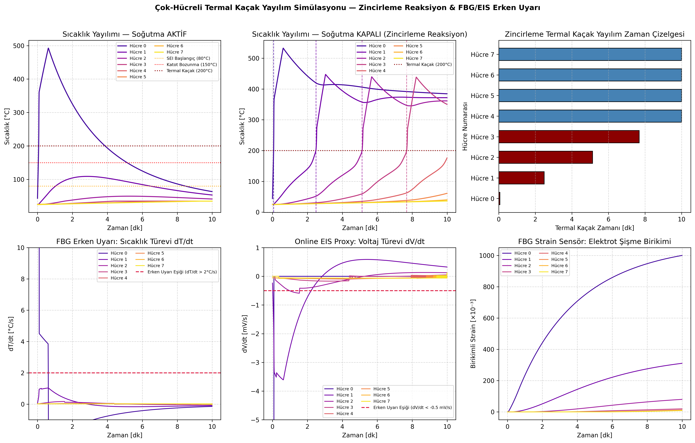
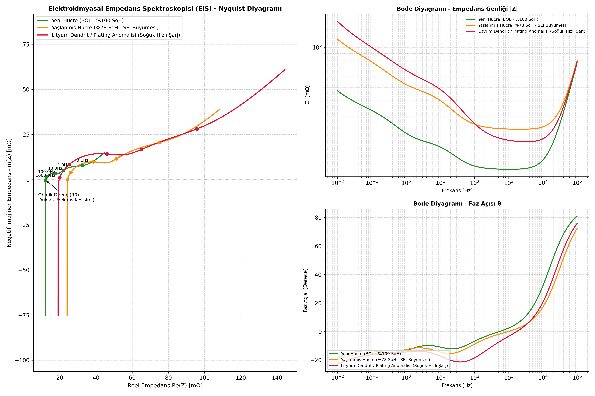
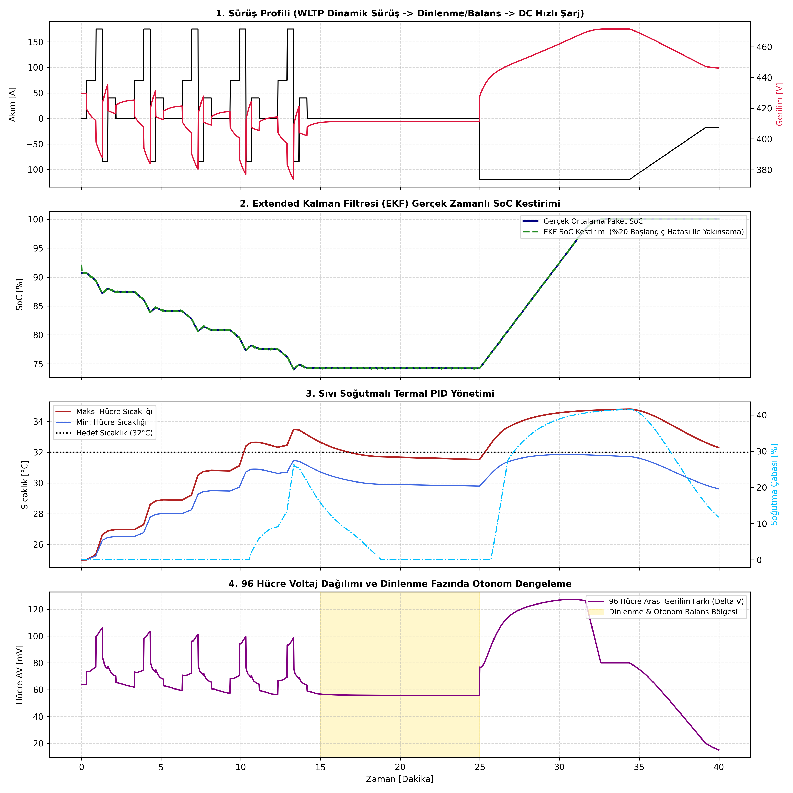

# Batarya Sistemleri Mühendisliği (BMS Academy)

<p align="center">
  
</p>

## 🚀 Proje Hakkında

Bu depo, modern **Batarya Yönetim Sistemleri (BMS)**, **Güç Elektroniği**, **Kestirim Algoritmaları** ve **Batarya Paket Tasarımı** üzerine hazırlanmış; akademik derinliğe sahip ve endüstri standartlarında (ISO 26262, AUTOSAR, MISRA C++, ISO 14229 UDS) pratik uygulamalar içeren kapsamlı bir uzmanlık kütüphanesidir. 

Hücrenin elektrokimyasal modellemesinden başlayarak, güç elektroniği donanım tasarımlarına, deterministik gömülü yazılımlara, Extended Kalman Filtreleri ile SoC/SoH kestirimine, çok-hücreli termal kaçak yayılım analizine, online EIS empedans spektroskopisine, UDS teşhis protokollerine ve tam entegre 96S elektrikli araç batarya paketi simülasyonuna kadar uzanan uçtan uca bir mühendislik müfredatı sunar.

---

## 📂 Müfredat ve Uygulama Yapısı

Aşağıdaki modüller, bir Batarya Sistem Mühendisinin uzmanlaşması gereken temel disiplinleri temsil eder. Her modül kendi içinde teorik dokümantasyonlar ve yüksek sadakatli (high-fidelity) simülasyon kodları barındırır:

| Modül | Teknik Odak Alanı | Akademik İçerik | Uygulama & Kod İçeriği |
| :--- | :--- | :--- | :--- |
| **[Modül 1](./01_Hucre_Modelleme_ve_Karakterizasyon)** | Hücre Modelleme & Karakterizasyon | LFP, NMC, LTO Karşılaştırmaları, 1-RC (Thevenin) & 2-RC Durum-Uzay Modelleri, OCV-SoC Polinomları, Arrhenius Sıcaklık Etkisi | [`cell_model_1RC.py`](./01_Hucre_Modelleme_ve_Karakterizasyon/cell_model_1RC.py): Dynamic Stress Test (DST) ile n-derece OCV hücre simülasyonu.<br>[`cell_model_2RC_hysteresis.py`](./01_Hucre_Modelleme_ve_Karakterizasyon/cell_model_2RC_hysteresis.py): 2-RC, LFP düz plato OCV, Plett histerezis, Arrhenius sıcaklık etkisi ve HPPC analizi. |
| **[Modül 2](./02_Guc_Elektronigi_ve_Donanim)** | Güç Elektroniği & Donanım Tasarımı | AFE SPI Daisy Chain Haberleşmesi, Şönt vs. Hall Akım Sensörleri Hata Analizi, Pasif & Aktif Balans Hesapları, ISO 6469-3 İzolasyon | [`precharge_simulation.py`](./02_Guc_Elektronigi_ve_Donanim/precharge_simulation.py): DC-Link ön şarj geçici durum RC simülasyonu ve inrush akım analizi.<br>[`cell_balancing_simulation.py`](./02_Guc_Elektronigi_ve_Donanim/cell_balancing_simulation.py): 12S modülde pasif vs aktif dengeleme ve ISO 6469-3 IMD izolasyon analizi. |
| **[Modül 3](./03_BMS_Yazilim_Mimarisi)** | BMS Gömülü Yazılım Mimarisi | AUTOSAR Katmanlı Mimarisi, RTOS Görev (Task) Zamanlamaları, MISRA C++ Güvenli Kodlama Standartları | [`bms_fsm.cpp`](./03_BMS_Yazilim_Mimarisi/bms_fsm.cpp): C++11 standartlarında deterministik FSM; PRECHARGE, BALANCING, kontaktör yapışma testi, asimetrik debounce ve NvM freeze-frame içerir. |
| **[Modül 4](./04_Tahmin_Algoritmalari)** | Kestirim Algoritmaları | Coulomb Counting Drift Analizi, 2D Extended Kalman Filter (EKF) Matematiksel Adımları, RLS ile SoH & Çok-Kısıtlı SoP | [`ekf_soc_estimator.py`](./04_Tahmin_Algoritmalari/ekf_soc_estimator.py): Gürültü filtreleyen 2D EKF SoC takipçisi.<br>[`rls_soh_sop_estimator.py`](./04_Tahmin_Algoritmalari/rls_soh_sop_estimator.py): Unutma faktörlü RLS ile çevrimiçi parametre takibi, SoH_R ve çok-kısıtlı SoP. |
| **[Modül 5](./05_Guvenlik_ve_Termal_Yonetim)** | Fonksiyonel Güvenlik & Termal | ISO 26262 ASIL-D HARA Analizi, Termal Kaçak (Thermal Runaway) Kinetiği, Arrhenius SEI/Katot Bozunması, EIS Spektroskopisi | [`thermal_pid_control.py`](./05_Guvenlik_ve_Termal_Yonetim/thermal_pid_control.py): Joule ısınmasını aktif PID kontrolcü ile soğutan termal denge simülasyonu.<br>[`thermal_runaway_propagation.py`](./05_Guvenlik_ve_Termal_Yonetim/thermal_runaway_propagation.py): 8-hücreli modülde termal kaçak yayılımı ve aktif soğutma bariyeri analizi.<br>[`eis_nyquist_simulator.py`](./05_Guvenlik_ve_Termal_Yonetim/eis_nyquist_simulator.py): Randles devresi ve Warburg difüzyonlu EIS Nyquist/Bode spektrum simülasyonu. |
| **[Modül 6](./06_Endustriyel_Protokoller_ve_Test)** | Endüstriyel Protokoller & Test | CAN 2.0B / CAN-FD, DBC Mesaj Paketleme & Sinyal Çözümleme, UDS (ISO 14229) Teşhis Servisleri, ISO-TP (ISO 15765-2) | [`bms_can_simulator.py`](./06_Endustriyel_Protokoller_ve_Test/bms_can_simulator.py): 8-byte raw CAN paketlerini bit seviyesinde kodlayan ve çözen simülasyon.<br>[`uds_diagnostic_simulator.py`](./06_Endustriyel_Protokoller_ve_Test/uds_diagnostic_simulator.py): UDS `0x10, 0x22, 0x27, 0x19, 0x14, 0x31, 0x34/36/37` ve ISO-TP simülatörü.<br>[`bms_can_database.dbc`](./06_Endustriyel_Protokoller_ve_Test/bms_can_database.dbc): VCU, şarj aleti ve teşhis cihazı için resmi Vector DBC veritabanı. |
| **[Modül 7](./07_Tam_Entegre_Batarya_Paketi_Simulasyonu)** | Tam Entegre 96S Paket Simülasyonu | Uçtan Uca Elektrikli Araç Batarya Paketi Simülasyonu (400V, 96S1P) | [`integrated_bms_pack_sim.py`](./07_Tam_Entegre_Batarya_Paketi_Simulasyonu/integrated_bms_pack_sim.py): WLTP sürüş döngüsü, EKF SoC takibi, PID sıvı soğutma, otonom balans ve DC hızlı şarjı birleştiren zirve simülasyonu. |

---

## 🛠 Kullanılan Teknolojiler ve Kütüphaneler

*   **Modelleme & Matematik:** Python (NumPy, SciPy, Matplotlib), **PyBaMM** (Python Battery Mathematical Modelling).
*   **Gömülü Geliştirme Standartları:** C++11/14/17, MISRA C++:2008, AUTOSAR MCAL/HAL Katmanları, FreeRTOS mimarileri.
*   **Haberleşme & Protokoller:** CAN 2.0B, CAN-FD, Vector DBC standardı, ISO 14229 UDS, ISO 15765-2 ISO-TP.
*   **Fonksiyonel Güvenlik:** ISO 26262 ASIL-D HARA, ISO 6469-3 / UN ECE R100 Yüksek Voltaj İzolasyon İzleme (IMD).
*   **Test & Kalibrasyon:** Otomatik birim test takımı (`unittest`), Vector CANoe/CANalyzer, dSPACE HIL Sistemleri.

---

## 📈 Simülasyon Çıktıları ve Analizler

Depoda yer alan yüksek doğruluklu simülasyonların ürettiği grafik ve analiz çıktıları aşağıda verilmiştir:

### 1. Hücre Dinamik Tepki Simülasyonu (Modül 1)
Dynamic Stress Test (DST) benzeri dinamik şarj/deşarj akım profili altında hücrenin terminal voltajı ($V_t$), açık devre voltajı ($OCV$) ve polarizasyon kapasitör voltajı ($V_{rc}$) geçici durum tepkileri:


### 2. 2-RC + Histerezis, HPPC ve Arrhenius Sıcaklık Etkisi (Modül 1)
LFP düz platolu OCV eğrisi, Plett histerezis zarflaması, Arrhenius sıcaklık etkisi ($25^\circ\text{C}$ vs $0^\circ\text{C}$) ve hızlı/yavaş polarizasyon ($\tau_1, \tau_2$) HPPC darbe cevabı:


### 3. Yüksek Voltaj Ön Şarj (Pre-charge) Analizi (Modül 2)
Inverter DC-Link kapasitörlerinin ($820\ \mu\text{F}$) ön şarj taş direnci ($47\ \Omega$) üzerinden şarj edilme eğrisi. Akım sınırlaması ve direnç üzerinde ısıya dönüşen kW seviyesindeki pik güç dağılımı:


### 4. Pasif vs. Aktif Dengeleme Karşılaştırması & ISO 6469-3 IMD (Modül 2)
12S modülde şönt dirençli pasif dengeleme ile indüktif aktif dengelemenin yakınsama süreleri, atık ısı ($Wh$) ve korunabilen paket kapasitesi karşılaştırması:


### 5. Extended Kalman Filter (EKF) ile SoC Kestirimi (Modül 4)
Şiddetli ADC ölçüm gürültüsü ve kasıtlı olarak **%35 hatalı** başlatılan SoC tahmininin EKF aracılığıyla saniyeler içerisinde gerçek değere nasıl yakınsadığı ve gürültüyü nasıl süzdüğü (Coulomb Counting ile karşılaştırmalı):


### 6. RLS ile Çevrimiçi SoH ve Çok-Kısıtlı SoP Kestirimi (Modül 4)
Unutma faktörlü Recursive Least Squares (RLS) ile yaşlanan ohmik direnç ($R_0$) takibi, direnç bazlı $\text{SoH}_R$ ve gerilim/SoC/donanım sınırlarını denetleyen 10 saniyelik ufuklu State of Power (SoP):


### 7. Aktif Soğutma PID Kontrol Simülasyonu (Modül 5)
Sürekli 45A deşarj altında hücrenin ürettiği Joule ısısının ($I^2 R$), aktif bir PID kontrolcü soğutma fanı debisiyle $35^\circ\text{C}$ hedef sıcaklıkta nasıl dengelendiği ve soğutma çabası:


### 8. Çok-Hücreli Termal Kaçak Yayılımı ve Erken Uyarı (Modül 5)
Arrhenius SEI ve katot ekzotermik reaksiyonları ile 8 hücreli modülde tırnak batması/kısa devre sonucu oluşan zincirleme kaçak yayılımı ve aktif sıvı soğutmanın koruma etkisi:


### 9. Elektrokimyasal Empedans Spektroskopisi - EIS Nyquist & Bode (Modül 5)
Yeni hücre, döngüyle yaşlanmış kalın SEI tabakası ve soğuk hızlı şarj anomalisi (Lityum dendriti / plating) durumlarının $10\text{ mHz} - 100\text{ kHz}$ empedans spektrumu:


### 10. Tam Entegre 96S Elektrikli Araç Batarya Paketi Simülasyonu (Modül 7)
WLTP dinamik sürüş döngüsü, precharge kontaktör sıralaması, EKF SoC takibi, sıvı soğutmalı PID termal yönetimi, otonom dinlenme balanslaması ve DC hızlı şarjın birleşik çalışması:


---

## 💻 Kurulum ve Çalıştırma Rehberi

Tüm simülasyonları, birim testleri ve analiz araçlarını yerel bilgisayarınızda çalıştırmak için aşağıdaki adımları takip edebilirsiniz:

1. **Depoyu Klonlayın:**
   ```bash
   git clone https://github.com/bahattinyunus/batarya-sistemleri-muhendisligi.git
   cd batarya-sistemleri-muhendisligi
   ```

2. **Gerekli Python Paketlerini Yükleyin:**
   ```bash
   pip install -r requirements.txt
   ```

3. **Tüm Simülasyonları ve Testleri Tek Komutla Çalıştırın:**
   ```bash
   python run_all_simulations.py
   ```

4. **Sadece Otomatik Birim Testlerini Çalıştırmak İçin:**
   ```bash
   python tests/test_bms_suite.py
   ```

---

## 🔬 İleri Nesil Batarya Teknolojileri ve BMS Trendleri

Geleneksel batarya yönetim sistemleri (BMS), araç üzerindeki gömülü donanımların (MCU/ASIC) sınırlı işlemci ve hafıza kapasitesi nedeniyle basit eşdeğer devre modellerine (ECM) ve Coulomb counting yöntemlerine dayanır. Ancak modern elektrikli araçlar ve şebeke tipi depolama sistemleri (ESS), bataryaların sınırlarını zorlamak ve güvenliği artırmak için yeni nesil teknolojileri entegre etmektedir.

```mermaid
graph TD
    subgraph Bulut Katmanı (Cloud-BMS / Dijital İkiz)
        DFN[Fiziksel DFN Elektrokimyasal Model]
        ML[AI/ML Kestirim: LSTM & Gaussian Process]
        OTA[Parametre Güncelleme - OTA]
    end

    subgraph Hücre İçi Algılama (In-situ Sensing)
        FBG[FBG Optik Fiber Sensörler: Sıcaklık & Şişme Basıncı]
        EIS[Online EIS: Dendrit ve Gaz Algılama]
    end

    subgraph Gömülü Edge Katmanı (Vehicle-AFE/MCU)
        ECM[1-RC Eşdeğer Devre Modeli]
        EKF[Extended Kalman Filter]
    end

    FBG -- "Hassas Gerilme/Sıcaklık" --> ECM
    EIS -- "İç Direnç Spektrumu" --> EKF
    ECM & EKF -- "Telemetri Verileri (4G/5G)" --> DFN & ML
    OTA -- "Güncellenmiş R, C, OCV Matrisleri" --> EKF
```

### 1. Bulut Tabanlı (Cloud-BMS) ve Dijital İkiz (Digital Twin) Mimarisi
Gömülü denetleyicilerin işlem gücü yetersizliğini aşmak için modern elektrikli araçlar, batarya verilerini 4G/5G telemetri üzerinden buluta aktarır. 
*   **Dijital İkiz:** Bulut üzerinde batarya paketinin fiziksel ve kimyasal bazlı yüksek sadakatli bir kopyası çalıştırılır. Burada **Doyle-Fuller-Newman (DFN)** gibi karmaşık elektrokimyasal modeller gerçek zamanlı simüle edilir.
*   **Makine Öğrenimi (AI/ML):** **LSTM (Long Short-Term Memory)** ve **Gaussian Process Regression (GPR)** gibi yapay zeka modelleri, bataryanın geçmiş kullanım profillerini analiz ederek Kalan Faydalı Ömrünü (RUL - Remaining Useful Life) ve yaşlanma trendlerini (SoH) sıfıra yakın hata payı ile kestirir. Bu modellerden elde edilen güncel direnç, kapasite ve termal parametreler Over-The-Air (OTA) güncellemeleriyle araç üzerindeki edge-BMS'e geri beslenir.

### 2. LFP Kimyasındaki OCV "Düz Platolu" (Flat-Curve) Kestirim Zorluğu
Lityum Demir Fosfat (LFP) piller, yüksek çevrim ömürleri ve termal kararlılıkları nedeniyle pazarda baskın hale gelmiştir. Ancak LFP pillerin şarj durumu ($SoC$) tahmininde BMS mühendisleri için ciddi bir zorluk bulunur:
*   **Düz OCV Eğrisi:** LFP pillerin Açık Devre Voltajı ($OCV$), %20 ile %90 SoC aralığında neredeyse tamamen düzdür (yatay plato). 
*   **Duyarlılık Problemi:** Voltmetre veya ADC üzerindeki **1 mV'luk** küçük bir ölçüm hatası veya gürültü, SoC tahmininde **%10 ila %15** arasında sapmalara yol açar.
*   **Çözümler:** Yeni nesil BMS algoritmaları, bu platoda sadece voltaja bakmak yerine **Histerezis modelleriyle entegre adaptif Kalman filtreleri**, **Fisher Bilgi Matrisi tabanlı sensör füzyonu** ve aracın kısa duraklama sürelerindeki gevşeme (relaxation) voltajlarını inceleyen makine öğrenimi tabanlı SoC sıfırlama (recalibration) yöntemlerini kullanır.

### 3. Sodyum-İyon (Na-Ion) Batarya Yönetimi
Lityuma alternatif olarak hızla ticarileşen Sodyum-İyon (Na-Ion) piller, düşük maliyet, ham madde bolluğu ve olağanüstü soğuk hava performansı sunar. Ancak SIB hücre yapısı BMS algoritmalarında özelleştirme gerektirir:
*   **Kimyasal Davranış Farkı:** Nominal voltajı lityuma göre daha düşüktür (~3.0 V) ve şarj/deşarj esnasında hücre içi direnç değişimi (impedance phase transitions) çok daha dramatiktir.
*   **BMS Adaptasyonu:** Hücrelerin şarj/deşarj ve balans limitleri Sodyum-İyon pilin kimyasal bozunma (failure modes) sınırlarına göre baştan tasarlanır.

### 4. Hücre İçi (In-situ) FBG (Fiber Bragg Grating) Optik Sensörleri
Geleneksel bataryalarda sıcaklık, hücrelerin dış yüzeyine yapıştırılan NTC/PTC dirençlerle ölçülür. Bu durum, hücre merkezinde oluşan termal kaçak precursor'larını (öncülerini) algılamada saniyelerce gecikmeye yol açar.
*   **FBG Sensörler:** Hücrelerin içerisine üretim esnasında saç teli inceliğinde fiber optik **Fiber Bragg Grating** sensörleri gömülür.
*   **Strain ve Sıcaklık Ayrımı:** Optik fiber üzerinden gönderilen ışığın kırılma dalga boyu değişimleri analiz edilerek hücre içi lokal sıcaklık dereceleri ve elektrotların şişmesinden (electrode swelling) kaynaklanan mekanik stres/basınç değişimleri milisaniyeler düzeyinde doğrudan ve elektromanyetik parazitlerden (EMI) tamamen bağımsız olarak ölçülür.

### 5. Çevrimiçi (Online / In-situ) Elektrokimyasal Empedans Spektroskopisi (EIS)
EIS, laboratuvar ortamlarında batarya karakterizasyonu için kullanılan frekans taramalı bir empedans ölçüm tekniğidir. Günümüzde bu teknolojiyi araç üzerine entegre etmeye yönelik yoğun AR-GE çalışmaları yürütülmektedir.
*   **Çalışma Prensibi:** BMS, araç çalışırken bataryaya küçük genlikli alternatif akım (AC) sinyalleri enjekte eder ve hücrelerin voltaj faz tepkilerini ölçerek gerçek zamanlı empedans spektrumu (Nyquist Plot) oluşturur.
*   **Erken Hata Tespiti:** EIS sayesinde, anotta oluşan lityum dendriti büyümesi (lithium plating) ve hücre içi gaz salınımları (gas evolution) henüz voltaj ve sıcaklıkta hiçbir değişim yaratmadan mikro seviyede tespit edilir ve termal kaçak başlamadan engellenir.

---

## ⚖️ Lisans

Bu proje MIT Lisansı ile lisanslanmıştır. Detaylar için [`LICENSE`](./LICENSE) dosyasına bakınız.
